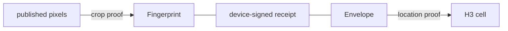

# C2PA private location attestation

Research prototype for thesis P27. A reader checks that a published photo is
a stated rectangle of an original signed by a trusted device, turned by a
stated multiple of 90 degrees, and that the
location the device sealed with it maps to a stated H3 cell. The original
pixels and the exact coordinate are not published.

## Background

**C2PA** attaches signed provenance to a media file: "Assertions are wrapped up
with additional information into a digitally signed entity called a claim"
([8], §1.3). Anyone can define assertions under their own namespace:
"Entity-specific namespaces shall begin with the Internet domain name for the
entity similar to how Java packages are defined" ([8], §6.2.1). This project
defines `edu.utdt.td8.zkloc`.

**VerITAS** lets an editor change a signed photo without breaking its
provenance. It "uses succinct zero-knowledge arguments to enable the editor to
make modifications to a captured C2PA image, and replace the signature with a
zk-SNARK that the edited image was derived from a properly signed C2PA image
via an authorized transformation" ([2], §1). The camera signs a lattice hash of
the image, because "the benefit of the lattice hash is that it uses only linear
operations over a finite field" ([2], §1). Its trust model is the one this
project inherits: "the only root of trust is the camera and its signing key"
([2], §3).

**HyperVerITAS** proves the same statement with multilinear polynomials: it
"builds on the insight of HyperPlonk [11], which showed how to generalize the
PLONK protocol to the Boolean hypercube, avoiding expensive FFTs and
significantly reducing prover memory" ([3], §1.1). It is instantiated with
"The PST scheme [31] - a multilinear variant [31] of the pairing-based
univariate KZG scheme" or with Brakedown ([3], §1.1). This project uses PST
because its proofs are small enough to sit inside a manifest: "our proof sizes
for HyperVerITAS PST are between 49-55KB" ([3], §5.2.1). Pixel values are
bounded with "a range proof (inspired by HyperPlonk) that ensures the witness
values fall within a small range (i.e., [0,255])" ([3], §1.1).

**ZKLP** proves a location claim without revealing the location, "enabling
users to prove to third parties that they are within a specified geographical
region while not disclosing their exact location" ([1], abstract). Regions are
H3 cells, and "The H3 indexing system supports differing granularity, with 16
resolutions" ([1], §2.3). The circuits are written in gnark, and "our
implementation supports Groth16 and Plonk as the SNARK" ([1], §5).

## How the proofs are bound

At capture the device computes two public values and signs them together in a
receipt:

- the **fingerprint**, the lattice (Ajtai) hash of the original pixels over the
  BLS12-381 scalar field, as in [2] and [3], with the original's width and
  height. The original is the whole camera frame, scaled down to at most 2^19
  pixels with its aspect ratio kept (836x627 for a 12 MP 4:3 photo);
- the **envelope**, a MiMC [7] commitment over BN254 to the coordinate, a
  fresh salt and the eight trigonometric hints the location circuit uses, from
  the zk-Location fork.

The published PNG carries the receipt, a HyperVerITAS PST proof that its
pixels are the claimed rectangle of the fingerprinted original, turned as
claimed, and a ZKLP
Groth16 [6] proof that the hints sealed in the envelope map to the claimed
cell. The coordinate sealed with them lies in that cell if the device computed
the hints from it (see [Known limits](#known-limits)). The two proofs run on
different fields and never reference each other. The device signature over
both values is what binds them to one capture.

The native app makes the location proof on the phone and sends the laptop the
proof instead of the coordinate. The laptop then makes the crop proof, which
needs the original.



## Layout

| Path | Contents |
| --- | --- |
| `crates/fingerprint` | The lattice fingerprint, built natively for the prover and for WebAssembly for the capture page |
| `crates/fingerprint-ffi` | A C ABI over `crates/fingerprint`, built as a static library for the iOS app |
| `crates/crop-proof` | The PST crop proof, extracted from HyperVerITAS |
| `location-proof` | Go CLI for the location proof, built against the zk-Location fork |
| `location-proof/zkloc` | The CLI's logic as a Go package: setup, cell, outline, hints, commit, prove, verify |
| `location-proof/mobile` | `zkloc` behind C functions that take and return JSON, built as a static library for the iOS app |
| `crates/provenance` | Capture, publish, the HTTP and TLS API, device pairing, reader checks, attacks, and the `provenance` CLI |
| `ios` | ProvenanceCapture, the native capture app. See [ios/README.md](ios/README.md) |
| `web` | The capture page a phone's browser opens, and the presenter page the laptop shows |
| `c2pa` | The C2P-19 custom assertion round trip with `c2patool` |
| `scripts` | `setup.sh` once, then `demo.sh phone` or `demo.sh` |
| `deploy` | The dev and prod servers on EC2: `dev` deploys to dev and `main` to prod. See [deploy/README.md](deploy/README.md) |

### Code from other repositories

| Repository | Revision | License | How it is used |
| --- | --- | --- | --- |
| [glgreiner/HyperVerITAS](https://github.com/glgreiner/HyperVerITAS), via the [C2PA-Thesis fork](https://github.com/C2PA-Thesis/HyperVerITAS) | `798554f` | MIT | Source of `crates/fingerprint` and `crates/crop-proof`, copied and restructured |
| [EspressoSystems/hyperplonk](https://github.com/EspressoSystems/hyperplonk), via [glgreiner/hyperplonk](https://github.com/glgreiner/hyperplonk) | `bed02ac` | MIT | Cargo dependency: sumcheck, product check, PST |
| [tumberger/zk-Location](https://github.com/tumberger/zk-Location), via the [C2PA-Thesis fork](https://github.com/C2PA-Thesis/zk-Location) | `793d561` on branch `c2p-77-sealed-hints` | none | Go module dependency: the FP32 circuit, envelope and native H3 mapping. Without a license its code is not copied here |
| [Consensys/gnark](https://github.com/Consensys/gnark), via [winderica/gnark](https://github.com/winderica/gnark) | `e30c94c` | Apache-2.0 | Groth16 and MiMC, replaced the same way the zk-Location fork does |
| [contentauth/c2pa-rs](https://github.com/contentauth/c2pa-rs) | `c2pa` 0.90 | MIT or Apache-2.0 | Signing and validating manifests. The sample certificate and photo come from its `c2patool-v0.27.16` tag |
| [arkworks-rs](https://github.com/arkworks-rs) | 0.4 | MIT or Apache-2.0 | Fields, curves and polynomials under the crop proof |
| [uber/h3-go](https://github.com/uber/h3-go) | v4.1.0 | Apache-2.0 | H3 cells [9] in location-proof |

## Run

Requires Rust (the toolchain pinned in `rust-toolchain.toml`), Go 1.23 or
later, Node 22, curl, and for the phone demo ngrok with an auth token
(`ngrok config add-authtoken <TOKEN>`). The iOS app also needs Xcode (built
and tested with Xcode 27.2). From the repository root:

```bash
scripts/setup.sh
```

Builds the CLI, the location prover and both pages, creates the proof
parameters, the device key and the TLS key the app pins (about 220 MB in
`.provenance`), and checks ngrok. Run it again at any time; it skips what
exists, except the location setup, which it redoes when
`params/location/version` is not `sealed-hints-v1` (parameters made before the
hints were sealed).

### Phone demo

```bash
scripts/demo.sh phone
```

The laptop serves the API and the pages on `127.0.0.1:8791`, the same API with
TLS on port 8792 of every LAN address for the app, and an ngrok tunnel to port
8791 for the browser. It opens the presenter page at
`http://127.0.0.1:8791/screen`, which shows two QR codes and every capture as
it arrives. macOS may ask whether `provenance` can accept incoming
connections; the app needs that.

With the app (recommended):

1. Build the two native libraries once (`ios/scripts/build-go.sh` and
   `ios/scripts/build-rust.sh`), then open `ios/ProvenanceCapture.xcodeproj`
   and run it in an iPhone Simulator or on an iPhone. The Simulator needs no
   team. An iPhone signed with a free Personal Team needs the steps in
   [ios/README.md](ios/README.md#on-an-iphone) once, and a new install from
   Xcode every 7 days.
2. Pair. On an iPhone on the same Wi-Fi as the laptop, scan the large QR code.
   The Simulator fetches the same payload from
   `http://127.0.0.1:8791/api/v2/pairing` by itself. The app then downloads the
   location prover's parameters from the laptop and checks their SHA-256
   against the QR code.
3. Take a photo (the Simulator uses a bundled photo and Xcode's simulated
   location), choose the rectangle to publish and the size of the cell, then
   tap Sign and send. The phone computes the fingerprint, the cell, the
   envelope and the location proof, signs the receipt and uploads the
   original with the proof. The coordinate and the salt stay on the phone.
4. The laptop verifies the location proof, proves the crop, signs the C2PA
   manifest and verifies the result. Both screens follow each step.

With the browser: scan the small QR code with the phone's camera. The capture
page opens over HTTPS through the tunnel and pairs the phone with the code in
the QR code. The free ngrok plan shows a notice first; tap Visit Site. The
page uploads the coordinate and the salt with the capture, and the laptop
makes both proofs, in about 20 s. See [web/README.md](web/README.md).

The presenter page also has a Verify a file tab: drop any PNG, such as a
forged copy from `out/attacks`, to run the reader checks on it. Ctrl-C stops
the server and the tunnel. `scripts/serve.sh` is the same command;
`scripts/publish.sh [ID]` publishes a stored capture from the terminal.

On 2026-10-30 the app path ran end to end in the iOS Simulator against
`scripts/demo.sh phone`: pairing, parameter download, cell and location proof
on the phone, upload, publish and reader checks. The stored capture directory
held `location_proof.json` and no `secrets.json`. The app has not run on an
iPhone yet.

### Laptop-only demo

```bash
scripts/demo.sh
```

A simulated capture with the laptop's device key, published and verified, then
every attack from [Attacks](#attacks), each rejected by the expected check.
`scripts/demo.sh --out DIR` writes the run somewhere else.

### The CLI

The scripts find cargo through `rust-toolchain.toml` when it is not on PATH.
What they run, by hand:

```bash
cargo install --path crates/provenance

provenance setup                   # build location-proof, create parameters and keys, fetch samples
provenance demo                    # capture, prove, publish out/signed.png, verify it
provenance verify out/signed.png   # run the reader checks on any file
provenance attack                  # forge tampered copies and check each outcome
provenance inspect out/signed.png  # print the assertion
provenance publish --capture DIR   # prove and publish any capture directory
provenance serve --web web/dist    # the pages and the API; publishes each upload as it arrives
provenance devices                 # list the trusted device keys
provenance devices revoke ID       # stop trusting one, named by a prefix of its id
```

```text
provenance demo
  photo     .provenance/sample.jpg
  place     UTDT, Buenos Aires (-34.5478, -58.4462)
  cell      87c2e3020ffffff
  out       out

  ✓ 1/6 capture           1.4s  fingerprint and envelope signed by device 4dd6…cc04
  ✓ 2/6 crop              0.0s  kept 443x591 at (0, 0)
  ✓ 3/6 location proof    0.8s  Groth16 proof for cell 87c2e3020ffffff, 196 bytes
  ✓ 4/6 crop proof       32.9s  HyperVerITAS PST proof, 36 KB
  ✓ 5/6 publish           0.0s  212 KB, C2PA-signed
  ✓ 6/6 verify            2.5s  all reader checks passed

✓ published out/signed.png in 38s
  next  provenance verify out/signed.png
        provenance attack --run out

The coordinate is a test input. The cell holds if the signing device computed the trigonometric hints honestly; see Known limits in the README.
```

`provenance devices` prints one line per trusted key: its id, its kind
(`declared: secure-enclave` or `software` for the app, `browser` for the
capture page, `laptop` for the demo's key, `unknown` for keys paired before
kinds were recorded), its name and when it was paired. The app declares its
own kind, and nothing checks it, so a Secure Enclave key shows as declared. Revoking a key makes files it
signed fail the device receipt check on this laptop.

`provenance demo --photo PATH --at LAT,LON --cell CELL` uses another photo and
simulated coordinate; nothing reads GPS from the photo. The demo publishes the
left half, and `--turn 1` to `--turn 3` turn it clockwise by quarter turns;
a phone capture publishes the rectangle drawn on the phone, turned as chosen
there. `--json` prints one
JSON object per line. Setup writes about 220 MB to `.provenance`, or to
`PROVENANCE_HOME`.

`out/original.png` and `out/secrets.json` are the private witness. Share only
`out/signed.png`.

### Capture directories

A capture is a directory: `original.png` (private), the location witness,
`receipt.json` (signed by the device), and `capture.json` (the cell and the
crop rectangle chosen at capture, the resolution, whether a phone or the demo
made it, and for the app whether iOS marked the fix as simulated or from an
accessory). The location witness is `secrets.json` (coordinate, salt and
hints, mode 0600) when the laptop makes the location proof, as for the demo
and the capture page, or `location_proof.json` (envelope and proof, public)
when the app made it. `provenance demo` writes one into `out` and publishes it
there. `provenance publish --capture DIR [--out DIR]` does the same for any
capture directory, including one a phone uploaded; with `location_proof.json`
it verifies that proof again instead of proving.

### Capture from a phone

Two clients capture on a phone. The app in `ios/` keeps its key in the Secure
Enclave on an iPhone, makes the location proof on the phone and talks to the
laptop over pinned TLS on the local network ([ios/README.md](ios/README.md)).
The capture page in `web/`, at `/`, runs in the phone's browser, keeps its key
in the browser, and sends the coordinate and the salt to the laptop through
the tunnel ([web/README.md](web/README.md)). The presenter page, at `/screen`,
is for the laptop.

`provenance serve --web web/dist` serves both pages and the API on
`127.0.0.1:8791`, the same API with TLS on `0.0.0.0:8792` for the app
(`--tls-port`, or `--no-tls` to skip it), and prints a pairing code for the
capture page. The TLS certificate is issued again at each start for the
laptop's current LAN addresses from a key kept in `.provenance/tls/`; the app
pins the SHA-256 of that key's SubjectPublicKeyInfo, so the pin survives a
change of network. The app's QR code names those LAN addresses; `--app-url
https://<host>:8792` (repeatable) adds one no interface carries, such as a
cloud instance's public IP behind NAT, and the app tries it first. Browsers
only allow the camera and geolocation over HTTPS,
so the capture page reaches the laptop through `ngrok http 8791`;
`--public-url` gives the tunnel's address to the presenter page for its QR
code. That QR code holds the pairing code in the URL fragment, which the
browser does not send to any server. Unless `--no-publish` is given, the
server publishes each accepted upload in the background, one proof at a time,
and verifies the result as a reader would.

The app's QR code holds JSON:
`{"v":1,"urls":["https://<lan-ip>:8792",...],"pin":"<hex>","token":"<hex>","params":{"proving.key":"<sha256>","circuit.r1cs":"<sha256>"}}`.
The token is 128 random bits, single use, and expires after 5 minutes. Every
refused pairing (wrong, used or expired token, or a signature that does not
match the key) counts, and after 5 the token is replaced. The presenter page
polls for the current token and redraws the QR code when it changes.

The plain listener sits behind a tunnel, so any route is reachable from the
internet unless it is marked below. A **Local** route answers only a request
from a loopback peer that names `localhost` or `127.0.0.1` as its host and
carries no `X-Forwarded-For` header, which ngrok adds. A request over the LAN
to the TLS listener is never Local. A **Direct** route refuses requests that
came through the tunnel, so refused attempts from the internet cannot replace
the token the QR code shows. Nothing private, the original or the secrets, is
served to anything but a Local request.

| Call | Only | Effect |
| --- | --- | --- |
| `GET /api/v2/pairing` | Local | The app's QR payload as JSON, with an `X-Expires-In` header in seconds. The Simulator reads it here instead of scanning |
| `GET /api/v2/session` | Local | The same payload as `{"qr", "expires_in"}`, for clients that predate `/api/v2/pairing` |
| `POST /api/v2/pair` | Direct | Adds the app's key when `token` is the current one and `signature` (base64 DER ECDSA P-256 SHA-256 over the token's UTF-8 bytes) verifies under `public_key` (PEM SPKI). Records `kind` (`secure-enclave` or `software`, as the app declares it, not checked) and `name` |
| `GET /api/params/location/{proving.key,circuit.r1cs}` | | The public Groth16 parameters the app proves with, with range requests |
| `POST /api/v2/captures` | | Stores an app capture (`original_png`, `receipt`, `cell`, `resolution`, `crop`, `accuracy_meters`, `location_proof`, `location: {simulated, accessory}`) with no secrets, after checking it, and starts publishing it |
| `POST /api/pair` | | Adds the capture page's key (`public_key`, P-256 PEM) when `code` matches the one printed. A key that is already trusted keeps its kind, name and pairing time |
| `GET /api/devices/{id}` | | Whether a device key id is trusted |
| `POST /api/cell` | | The H3 cell the location circuit maps `latitude`, `longitude` to at `resolution`, or a refusal for cells it cannot represent or resolutions outside 4 to 9 |
| `GET /api/cells/{cell}` | | The cell's corners and area, for a map |
| `POST /api/captures` | | Stores a capture page capture (`original_png` in base64, `secrets`, `receipt`, `cell`, `resolution`, `crop`, `accuracy_meters`) after checking it, and starts publishing it |
| `GET /api/captures/{id}` | | The capture's phase, its publish and check events, the device kind, and the claim once verified |
| `GET /api/captures/{id}/signed.png` | | The published file |
| `POST /api/verify` | | Runs the reader checks on the PNG in the body, up to 8 MiB like every body |
| `GET /api/session` | Local | The pairing code and the capture page QR code's address |
| `GET /api/captures` | Local | The newest captures |
| `GET /api/captures/{id}/original.png` | Local | The private original |
| `POST /api/captures/{id}/publish` | Local | Publishes the capture again |

Both upload routes refuse a capture unless the fingerprint matches the pixels
and the receipt is signed by a trusted key. `POST /api/captures` also checks
that the envelope matches the secrets and that the cell is the one the circuit
gives for the coordinate at that resolution. `POST /api/v2/captures` checks
that the cell is at the stated resolution and that `location-proof verify`
accepts the proof for the receipt's envelope and that cell. Both refuse a
resolution outside 4 to 9 (`RESOLUTIONS` in
`crates/provenance/src/location.rs`). H3's cell statistics table [9] gives an
average hexagon area of 1,770.35 km² at resolution 4 and 0.105 km² at 9.
Every refusal is a 400 with `{"error": "..."}`, and every other error on any
route answers the same body with its own status, such as 413 for a body over
8 MiB.
`crates/provenance/tests/serve.rs` exercises the checks, both kinds of
pairing, token expiry and rotation, the parameter route against the QR
digests, the TLS listener with the pinned key, an app upload with a proof from
`location-proof prove` that leaves no secrets on disk, and that nothing private
answers a request through the tunnel. It runs in CI after setup.

The capture page computes the fingerprint itself, with `crates/fingerprint`
built for `wasm32-unknown-unknown` (`cargo build --profile wasm -p fingerprint
--target wasm32-unknown-unknown`). On an iPhone running iOS 18.7 it took 12.8 s
across four web workers, with the same digest as the native build, measured on
2026-09-16. It asks the laptop for the cell (`POST /api/cell`, which calls the
Go tool's `cell` subcommand). The app links the same Rust code and the same Go
package as static libraries and computes the fingerprint and the cell itself.

Trusted device keys live in `.provenance/trusted/`, one PEM per key, named by
key id, with an optional `<id>.json` next to it holding the kind, name and
pairing time. The first pairing writes it; capture page pairing does not
replace it, because that pairing shows no possession of the key. Readers only
use the PEMs. Setup adds the laptop's simulated
device; pairing adds a phone.

## Reader checks

The two proofs are verified separately, and they meet only in the receipt: the
crop proof is checked against the signed fingerprint and the location proof
against the signed envelope. Each check first says what it is about to
establish, then its outcome. The checks run in order and stop at the first
rejection.

| Check | Rejects the file when | Exit status |
| --- | --- | --- |
| C2PA manifest | c2pa-rs reports it neither Valid nor Trusted, it lacks exactly one `edu.utdt.td8.zkloc` assertion, or the assertion is not version 5 or 6 | 10 |
| Device receipt | the receipt is not signed by a trusted device key | 11 |
| Crop proof | the file's pixels are not the claimed rectangle, turned as claimed, of the image the receipt fingerprints | 12 |
| Location proof | the claimed cell's resolution is outside 4 to 9, or the proof does not verify for the receipt's envelope and the claimed cell | 13 |

A demo run on a 4032x3024 photo, whose original is 836x627:

```text
provenance verify
  file      out/signed.png

  ✓ C2PA manifest      0.0s  reading the C2PA manifest and validating its claim signature → valid, with one edu.utdt.td8.zkloc assertion
  ✓ device receipt     0.0s  checking the device signature over fingerprint 4df3…6170 and envelope 0x2589…15b3 → signed by trusted device 4dd6…cc04 at 2026-11-02T19:34:41Z
  ✓ crop proof         1.6s  verifying that the published pixels are the 418x627 at (0, 0) of the original with fingerprint 4df3…6170 → proof accepted
  ✓ location proof     0.1s  verifying that the hints sealed in envelope 0x2589…15b3 map to cell 87c2e3020ffffff → proof accepted

✓ accepted
  these pixels are the 418x627 at (0, 0) of an original that device 4dd6…cc04 signed,
  together with an envelope whose sealed hints map to cell 87c2e3020ffffff, at 2026-11-02T19:34:41Z (device time)
  The sealed coordinate lies in that cell if the signing device computed the hints from it; see Known limits in the README.
```

A rejected file stops at the failing check, which prints its reason, and the
checks after it show as not run. `--json` prints one object per check event,
then the verdict. A file from before this version stops at the first check:

```text
  ✗ C2PA manifest      0.0s  reading the C2PA manifest and validating its claim signature → the edu.utdt.td8.zkloc assertion is version 4, and this reader only reads version 5 (full-frame originals and crop proofs bound to their statement)
```

Short identifiers show the first and last four hex digits. The fingerprint's is
the SHA-256 of its JSON and only names it on screen. Only when every check
passes, `provenance verify --json` returns the joint statement as `claim`, with
the device key id, capture time, fingerprint digest, envelope and cell in full.

## Attacks

`provenance attack` writes each forgery as a freshly C2PA-signed PNG, so the
outcome has to come from the checks above. The attacker holds the device key,
the photographer's secrets and a second genuine capture: the same photo
mirrored, taken at Tokyo Station.

| Attack | Tampering | Outcome |
| --- | --- | --- |
| `signature` | flip one bit of the device signature | rejected by the device receipt |
| `untrusted-device` | sign the same fields with a key that was never paired | rejected by the device receipt |
| `fingerprint` | swap two fingerprint values | rejected by the device receipt |
| `resigned-fingerprint` | swap two fingerprint values and re-sign with the device key | rejected by the crop proof |
| `pixel` | change one published pixel | rejected by the crop proof |
| `rectangle` | claim the same pixels are one column to the right | rejected by the crop proof |
| `turn` | turn the published pixels half a turn and claim that turn | rejected by the crop proof |
| `region` | claim the other capture's cell for this location proof | rejected by the location proof |
| `cross-photo-location` | attach the other capture's location proof and cell | rejected by the location proof |
| `cross-photo-receipt` | attach the other capture's receipt, location proof and cell | rejected by the crop proof |
| `signed-elsewhere` | sign this photo at Tokyo with the device key and prove that cell | accepted: the device is trusted |
| `fine-cell` | publish the honest coordinate in a resolution-13 cell (about 44 m²) | rejected by the location proof: only resolutions 4 to 9 |

The accepted case marks what the pipeline trusts rather than checks. The
attacks on the proofs themselves are tests, described in
`docs/security/security-analysis.tex`. Two of them run end to end on the demo's
file (`crates/provenance/tests/forged_crops.rs`): a third party replaces the
published crop and re-signs the manifest with the sample key. With the honest
crop proof (A2) the reader rejects it at the crop proof, since the proof's
challenges now depend on the published pixels. With a forged crop proof (A3)
the reader accepts it.

The prover side of a wrong cell is covered in `location-proof/main_test.go`:
the honest prover refuses a cell that does not contain the coordinate, and
`commit` and `prove` refuse hints more than one float32 ulp away from the ones
the coordinate gives. The circuit side of forged hints is covered in the fork
(see [Known limits](#known-limits)).

## Assertion

`edu.utdt.td8.zkloc`, version 6. Version 6 adds `turn`. With no turn the crop
proof hashes the same statement as in version 5, so the reader also accepts
version 5 files, which have no turn. Version 5 lets the original be any size
up to 2^19 pixels and makes the crop proof hash its whole statement into the
transcript, so a version 4 image proof does not verify. Version 4 changed what
the envelope commits to. The reader refuses other versions. A turned file also
lists the `c2pa.orientation` action, next to `c2pa.cropped`.

| Field | Contents |
| --- | --- |
| `receipt.fingerprint` | 128 BLS12-381 scalars per RGB channel, and the original's size, at most 2^19 pixels. The crop proof takes the size from here |
| `receipt.envelope` | BN254 scalar: MiMC over the latitude and longitude bits, the salt and the eight hint bit patterns, in that order |
| `receipt.captured_at` | RFC 3339 time asserted by the device |
| `receipt.device` | SHA-256 of the device public key in SubjectPublicKeyInfo DER |
| `receipt.signature` | Base64 DER ECDSA P-256 over the compact JSON of the four fields above |
| `cell` | H3 cell the location proof claims |
| `crop` | The rectangle of the original the crop proof claims, as `x`, `y`, `width`, `height` in pixels from the top-left. The proof transcript starts from a hash of the original's size, this rectangle, the turn, the fingerprint and the published pixels |
| `turn` | Quarter turns clockwise applied after the crop, 0 to 3. A turn only reorders pixels, so the crop proof checks it with the same selection as the rectangle, at no extra cost. Absent in version 5, and read as 0 |
| `location_proof` | Base64 Groth16 proof |
| `image_proof` | Base64 PST proof |

## Known limits

- **The cell holds for the coordinate only if the signing device computed the
  hints from it.** ZKLP argues soundness from identities among its hint outputs: "Soundness
  holds as P_ZKLP evaluates that (i) γθ² + δθ² equals 1, and thereby fulfills
  the fundamental trigonometric identity, (ii) δθ · αθ equals γθ, which checks
  if the same angle is used, and (iii) 2 · γθ · δθ equals βθ" ([1], §4). None
  of the three involves the coordinate θ itself; that reading is ours. The
  fork's circuit stated the consequence: "The trigonometric hint outputs are
  not constrained back to Lat/Lng; callers must not treat this PoC circuit as
  malicious-prover sound until that upstream limitation is fixed"
  (`loc2index32/circuit.go` at `cc8f1c7`). The attack now runs as a test in
  the fork (`loc2index32/circuit_test.go` at `793d561`):
  `TestLegacyCircuitAcceptsForgedHints` gives a copy of the old circuit an
  honest envelope for UTDT and the hints of Tokyo, and the constraints are
  satisfied for Tokyo's cell. The fork now takes the eight hints as secret
  inputs and hashes them into the envelope with the coordinate and the salt,
  and the device signs that envelope in the receipt, so the cell is tied to
  the sealed hints, and changing them changes the envelope the device signed.
  `TestSealedCircuitRefusesForgedHints` shows that the same forgery, and the
  honest hints with Tokyo's cell, no longer satisfy the constraints against
  the honest envelope. The hints are trusted to belong to the sealed
  coordinate only because the signing device computed them: the app on the
  phone, or the capture page in the browser. The circuit "still does not
  derive them from Lat and Lng" (`loc2index32/circuit.go` at `793d561`), and
  `TestSealedCircuitTrustsTheEnvelopeSigner` shows that hints of another
  coordinate, sealed into a new envelope, still satisfy them. The fork's
  README puts it as "as trustworthy as the party that computes and signs the
  envelope" (Setup artifacts and trust warning). `location-proof` refuses
  hints that do not match the coordinate before it proves, but that is a
  check in honest code, not a constraint. The three tests use gnark's
  `test.IsSolved`, which checks the witness against the constraints.
  `location-proof/zkloc/attack_test.go` runs the same two cases with the real
  proving key: Tokyo's hints do not prove against the honest envelope, and
  sealed into a new envelope they prove and verify for Tokyo's cell.
- **The original image is not hidden.** The fingerprint is deterministic, so
  anyone holding a candidate original can test it, and the PST proof carries
  unmasked evaluations of the original's channel polynomials (see
  `image_openings` in `crates/crop-proof/src/crop.rs`).
- **Only the exact coordinate is hidden.** The file publishes the claimed cell,
  the capture time and the device key id. The key id links every photo taken
  with one device, so their cells and times can trace where the photographer
  went. What the published rectangle shows can also give the place away.
- **The envelope's hiding is assumed, not analyzed.** It is MiMC over the
  coordinate, a fresh 248-bit salt and the eight hints, added in the
  zk-Location fork. The hints are a function of the coordinate, so only the
  salt adds randomness. None of [1], [2] or [3] analyzes it as a hiding
  commitment.
- **Both setups are single-party.** Whoever runs `provenance setup` could keep
  the trapdoors and forge either proof. The app proves with parameters it
  downloads from the laptop, checked only against the digests in the QR code
  the same laptop shows.
- **The receipt signs neither the cell nor the resolution.** The device signs
  the fingerprint, the envelope, the time and its key id. The cell, the
  resolution and the crop rectangle sit unsigned in `capture.json` and in the
  assertion. One envelope can be proved against any cell from resolution 4 to
  9 that contains the point its hints give (on 2026-10-30 one envelope proved
  and verified at resolutions 4, 7 and 9). Whoever holds the secrets can
  therefore publish the capture with a finer or coarser cell than the one
  chosen at capture. On the capture page path that is the laptop, which
  receives `secrets.json`, so the photographer's choice of cell size is not
  protected against it. On the app path the phone makes the proof, the laptop
  receives a proof for one cell, and `POST /api/v2/captures` and `publish`
  check the cell against that proof. Every accepted cell still contains the
  point. On both paths the laptop makes the crop proof from the original, so
  it chooses the published rectangle.
- **Nothing shows a third party where the device key lives.** `demo` signs
  with a key file on the laptop, at a coordinate and time given as inputs. The
  capture page signs with a browser key that never leaves the browser. The app
  on an iPhone signs with a Secure Enclave key, which cannot be extracted:
  "Not having a mechanism to transfer plain-text key data into or out of the
  Secure Enclave is fundamental to its security" ([10], Overview). But the
  laptop receives only a public key and the `kind` the app declares, and
  nothing lets it or a reader check that the key is in an enclave. The
  presenter page and `provenance devices` therefore show it as declared. Only
  Apple's App Attest would let a third party verify it: it uses "Apple
  servers to certify that the key belongs to a valid instance of your app"
  ([11], Overview). It needs "an App ID that you
  register on the" Apple Developer website (same section), and a free
  Personal Team has no such registration: its "App IDs, devices,
  certificates, and provisioning profiles are managed directly in Xcode"
  ([12], Enable a personal team in Xcode). This project does not use App
  Attest. The pairing token or code is all that ties a key to this laptop.
  [2] assumes "the attacker cannot extract the signing key from the camera"
  (§3), and this project assumes the same of whichever key is paired. The
  C2PA editor signs with the SDK sample certificate, which no trust list
  includes.
- **The crop proof, and so the original, stays on the laptop.** [3] reports a
  prover peak memory of 6.4 GB for HyperVerITAS PST on a full-system crop of
  a 2^19-pixel image (Table 3), the largest original this project takes. On
  2026-10-30, `/usr/bin/time -l` on the laptop measured a peak memory
  footprint of 5.9 GB for the crop proof, and 75 MB and 0.33 s for
  `location-proof prove`. The app therefore proves the location on the phone
  and uploads the original for the crop proof. The laptop sees the whole
  original, but receives neither the coordinate nor the salt from the app: an
  app capture directory holds `location_proof.json` and no `secrets.json`.
  The capture page still sends both. A crop proof on the phone was not tried.
- **One edit, at reduced resolution.** Only a rectangular crop of the
  original, optionally turned by a multiple of 90 degrees. Turns by other
  angles, blur and grayscale are not proved. The original is the camera frame scaled down to at most 2^19
  pixels. The full-resolution photo is not signed or proved. Every original
  shares one set of proof parameters, so smaller originals cost the same as
  the largest; the prover's time and memory grow with the pixel count, and
  the parameters only go up to 2^19.

## Measurements

Median of three runs per side on 2026-09-14, macOS 26.5.2 on Apple arm64,
alternating the PR #3 Python pipeline (`8/8 ALL DEMO STAGES PASSED` in every
run) with `provenance` on the same sample photo and coordinate. Proof
parameters were already set up for both. The table predates the sealed hints
and was not measured again; the one demo run shown under
[The CLI](#the-cli), on 2026-10-30, is close to it.

| Step | PR #3 | This repository | Speedup |
| --- | ---: | ---: | ---: |
| Capture: fingerprint, envelope, receipt | 8.41 s | 1.75 s | 4.8x |
| Crop | 0.33 s | under 0.01 s | |
| Location proof | 0.63 s | 0.62 s | 1.0x |
| Crop proof | 132.32 s | 17.70 s | 7.5x |
| Publish | 0.26 s | 0.02 s | 13x |
| Capture to verified file | 145.34 s | 21.24 s | 6.8x |
| Reader verification, standalone | 3.35 s | 1.02 s | 3.3x |
| Attacks (6 in PR #3, 7 here) | 21.56 s | 6.02 s | 3.6x |

The location proof runs the same circuit and gnark prover in both, so it does
not change. The crop proof is faster mostly because its parameters are loaded
without re-checking every curve point (they are pinned by SHA-256 instead),
and the fingerprint and `r^T A` computations use every core. For PR #3,
"capture to verified file" is the sum of its first six stage timings.

| Output | PR #3 | This repository |
| --- | ---: | ---: |
| Location proof | 196 bytes | 196 bytes |
| Crop proof | 36,692 bytes | 36,692 bytes |
| Signed PNG | 317,491 bytes | 200,709 bytes |

## References

1. J. Ernstberger, C. Zhang, L. Ciprian, P. Jovanovic, S. Steinhorst. "Zero-Knowledge Location Privacy via Accurate Floating-Point SNARKs". IEEE Symposium on Security and Privacy, 2025. [arXiv:2404.14983](https://arxiv.org/abs/2404.14983).
2. T. Datta, B. Chen, D. Boneh. "VerITAS: Verifying Image Transformations at Scale". IEEE Symposium on Security and Privacy, 2025, pp. 4606–4623. [doi:10.1109/SP61157.2025.00097](https://doi.org/10.1109/SP61157.2025.00097), [ePrint 2024/1066](https://eprint.iacr.org/2024/1066).
3. G. Greiner, T. Mowery, P. Soni. "HyperVerITAS: Verifying Image Transformations at Scale on Boolean Hypercubes". Proceedings on Privacy Enhancing Technologies 2026(2), pp. 58–75. [doi:10.56553/popets-2026-0036](https://doi.org/10.56553/popets-2026-0036).
4. B. Chen, B. Bünz, D. Boneh, Z. Zhang. "HyperPlonk: Plonk with Linear-Time Prover and High-Degree Custom Gates". EUROCRYPT 2023, LNCS 14005, pp. 499–530. [doi:10.1007/978-3-031-30617-4_17](https://doi.org/10.1007/978-3-031-30617-4_17).
5. C. Papamanthou, E. Shi, R. Tamassia. "Signatures of Correct Computation". [ePrint 2011/587](https://eprint.iacr.org/2011/587).
6. J. Groth. "On the Size of Pairing-Based Non-interactive Arguments". EUROCRYPT 2016, pp. 305–326. [ePrint 2016/260](https://eprint.iacr.org/2016/260).
7. M. Albrecht, L. Grassi, C. Rechberger, A. Roy, T. Tiessen. "MiMC: Efficient Encryption and Cryptographic Hashing with Minimal Multiplicative Complexity". ASIACRYPT 2016. [ePrint 2016/492](https://eprint.iacr.org/2016/492).
8. Coalition for Content Provenance and Authenticity. [C2PA Technical Specification 2.2](https://spec.c2pa.org/specifications/specifications/2.2/specs/C2PA_Specification.html).
9. Uber Technologies. [H3: a hexagonal hierarchical geospatial indexing system](https://h3geo.org), and its [table of cell statistics](https://h3geo.org/docs/core-library/restable/).
10. Apple. [Protecting keys with the Secure Enclave](https://developer.apple.com/documentation/security/protecting-keys-with-the-secure-enclave).
11. Apple. [Establishing your app's integrity](https://developer.apple.com/documentation/devicecheck/establishing-your-app-s-integrity).
12. Apple. [Developer account overview](https://developer.apple.com/support/compare-memberships/).
